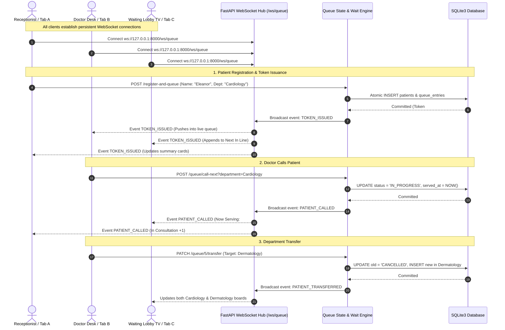
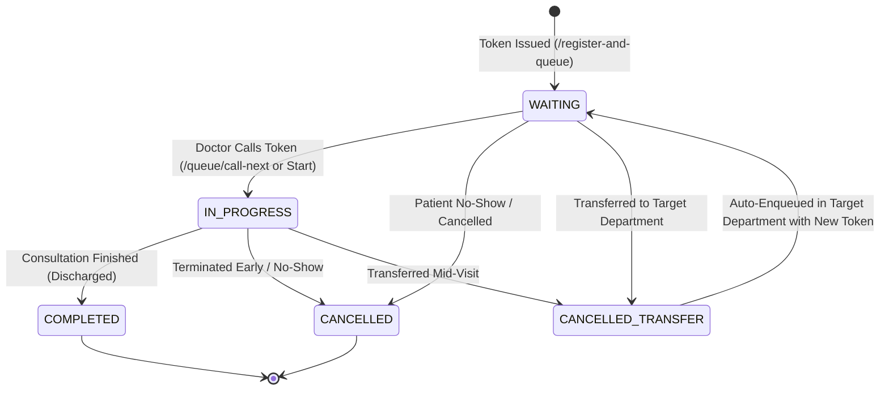

# MediQueue — System Architecture & Real-Time WebSocket Design

This document details the real-time event-driven architecture, WebSocket lifecycle, database design, and queuing formulas for MediQueue.

---

## 1. Real-Time WebSocket Architecture

---

## 2. Queue Lifecycle State Machine

---

## 3. Waiting-Time Calculation Model

$$\text{Estimated Wait Time (minutes)} = (N_{\text{active waiting ahead}} \times D_{\text{dept}}) + \left(\frac{D_{\text{dept}}}{2} \text{ if active doctor session}\right)$$

### Department Standard Baselines:
- **Cardiology:** 15 minutes
- **Orthopedics:** 12 minutes
- **General Medicine:** 10 minutes
- **Pediatrics:** 10 minutes
- **Dermatology:** 10 minutes

*Queue depth $N_{\text{active waiting ahead}}$ is dynamically evaluated from SQLite for entries with $\text{status} = \text{'WAITING'}$ and $\text{id} < \text{current\_entry.id}$. When patients ahead are completed, marked no-show, or transferred, queue depth decreases instantaneously and broadcasts to all clients.*
